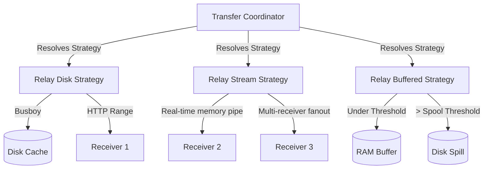
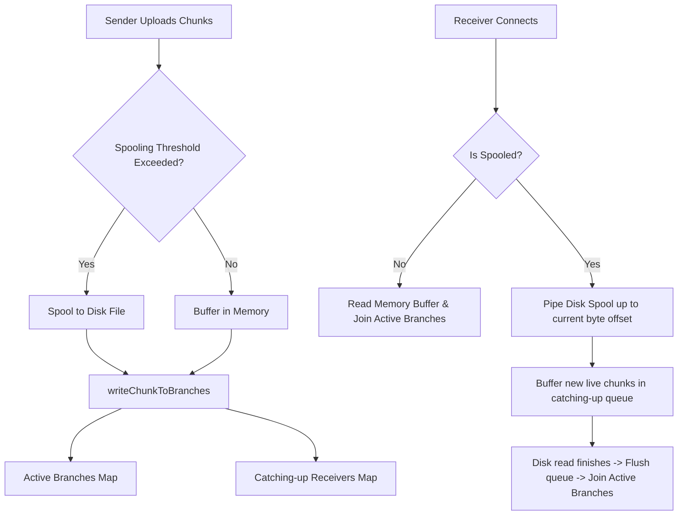

# JAVIN FileShare — High-Performance LAN File Sharing

[](https://github.com/venkatbayanaboina/Javin-Share-/actions)
[](https://opensource.org/licenses/MIT)
[](https://nodejs.org/)

**JAVIN FileShare** is a secure, high-performance local network (LAN) file-sharing platform designed for rapid, direct transfers between devices on the same Wi-Fi network or mobile hotspot. By eliminating cloud dependencies, JAVIN FileShare ensures maximum bandwidth utilization and strict data privacy—your files never leave your local physical network.

---
## Key Features

* **Multi-Platform Support**: Fully responsive web client compatible with Windows, macOS, Linux, iOS, and Android modern browsers.
* **Instant Session Joining**: Passwordless pairing via dynamically generated **PINs** and high-contrast **QR codes**.
* **Zero-Cloud Architecture**: Encrypted TLS-based transport (`HTTPS`) communicating directly between devices over the local network.
* **Large File Capacities**: Support for files up to **50 GB** and beyond, controlled dynamically by configurable upload caps.
* **Real-time Session Sync**: Real-time page coordination, lock states, download queues, and progress tracking powered by **Socket.IO** (control channel only — file bytes travel over streaming HTTP).
* **Refresh-Safe Transfers**: A sender reloading their page never scatters receivers — server-side grace windows distinguish a refresh from a real departure. The Screen Wake Lock API keeps phones from throttling long transfers.
* **Authoritative Security**: Host-only administrative controls, automated failed PIN rate-limiting, multi-layer transfer-id validation against path traversal, and deep path/filename sanitization.

---

## How it Works: Core Architecture

JAVIN FileShare uses a **server-relayed transfer architecture** controlled by a dynamic **Transfer Coordinator Service**. Rather than relying on fragile WebRTC peer-to-peer handshakes which frequently fail across strict corporate routers, the platform orchestrates transfers using three optimized strategies:



### 1. Relay Disk Strategy (`relay-disk`)
* **Behavior**: Chunks are uploaded and written to disk under the temporary uploads cache using stream-based Busboy parsers.
* **Optimization**: Served to receivers using HTTP **Range-based requests**, allowing for robust partial content serving, chunk offset uploads, and transfer resumption after network disconnection.

### 2. Relay Stream Strategy (`relay-stream`)
* **Behavior**: Uploaded bytes are piped **directly and in real-time** from the sender's upload socket/request into the connected receivers' active HTTP download streams using in-memory PassThrough pipelines.
* **Optimization**: Multi-receiver fan-out with zero disk footprint and near-instantaneous starting latencies.

### 3. Relay Buffered Strategy (`relay-buffered`)
* **Behavior**: A highly optimized hybrid strategy. 
* **Optimization**: Files smaller than the `spoolThresholdBytes` are kept entirely in-memory for lightning-fast RAM-to-RAM pipelining. If a file exceeds this threshold, the strategy automatically spools and spills remaining chunks to disk on-the-fly, keeping server memory usage constant.
* **Memory Safety & Sequential Integrity (Updated)**:
  * **Lagging Queue Pattern**: Catching-up and late-connecting downloaders read spooled disk chunks first. New live chunks are queued in memory and flushed in order after catch-up is complete, preventing out-of-order chunk interleaving (file corruption).
  * **Backpressured Pipe**: Spooled disk reads use a backpressured stream pipe to pause reading if a receiver is slow.
  * **16MB Safety Hard-cap**: Automatically drops extremely stalled downloaders whose queued buffers exceed 16MB to prevent RAM exhaustion.

Here is the detailed flow diagram for the updated `relay-buffered` strategy:



---

## Directory Structure

```
Javin-Share-/
├── backend/
│   ├── server.js                 # Launcher entrypoint (boots index.js)
│   ├── src/
│   │   ├── config.js             # Shared app & strategy configuration
│   │   ├── routes/               # HTTP endpoints (health, upload, download, session)
│   │   ├── sockets/              # Socket.IO handlers & room management
│   │   ├── state/                # Store singleton (sessions, active files, download queues)
│   │   └── services/
│   │       ├── transfer/         # Coordinator & Strategies (disk, stream, buffered)
│   │       ├── session.service.js     # Host-client handshake & state orchestration
│   │       └── download-queue.service.js  # Multi-client queue and backpressure services
│   └── test/                     # 65-test suite (unit, integration & security regression)
├── frontend/
│   ├── host.html                 # Host admin panel (PIN/QR generator)
│   ├── join-pin.html             # Client pin verification portal
│   ├── session.html              # Central Session file sharing hub
│   ├── send-files.html           # Sender file-staging interface
│   ├── receive-files.html        # Receiver queuing & progress interface
│   ├── history.html              # Transfer history & device naming
│   ├── session-ended.html        # Session termination interface
│   └── assets/                   # Client ES6 modules (js/) & modular stylesheets (css/)
├── docs/
│   ├── evaluation_of_architecture.md # Benchmark methodology, results & strategy routing
│   ├── SOCKET_EVENTS.md          # Socket.IO event contract (client ⇄ server)
│   ├── PROJECT_REVIEW_AND_REDESIGN.md # Full review: security, UI redesign & roadmap
│   ├── SECURITY.md               # LAN security model and rate-limit controls
│   └── benchmarks/               # Append-only benchmark result log (BASELINE.md)
├── package.json                  # Root script orchestration
└── launchers/                    # Native platform launchers & installers
    ├── setup (for Windows).bat
    ├── Javin FileShare (for macOS & Linux).sh
    ├── FileShare (for macOS).command
    ├── Javin FileShare (for Linux).desktop
    └── Javin FileShare (for Windows).vbs
```

*Note: Legacy endpoints (such as `/main.html`, `/index.html`) automatically issue **301 permanent redirects** to the correct, modern thinned functional shells.*

---

## Prerequisites

* **Node.js 18.0.0+**
* **Git** (includes OpenSSL on Windows for local self-signed TLS cert generation)

---

## Quick Start

### 1. Windows Execution
Double-click `launchers/setup (for Windows).bat` (automatically checks privileges, provisions certs, installs modules, and spins up the server), or run:
```cmd
cd backend
npm install
node server.js
```

### 2. macOS / Linux Execution
Execute the shell launcher to automatically locate Node.js, run configuration audits and boot:
```bash
"./launchers/Javin FileShare (for macOS & Linux).sh"
```
On macOS you can simply double-click `launchers/FileShare (for macOS).command`.
Or run manually:
```bash
cd backend
npm install
node server.js
```

The launcher opens `https://localhost:4000` on the hosting machine automatically (joining devices scan the QR code, which points at the advertised `javin.share.local` hostname). The launcher installs the local self-signed certificate into the system trust store; if the admin password prompt is dismissed, browsers will show a one-time certificate warning.

---

## Development & Verification

JAVIN FileShare enforces a strict continuous-integration quality standard. Adjust performance parameters by copying `.env.example` to `.env`.

```bash
# Install dependencies
cd backend && npm install

# Boot development environment with hot-reloading
npm run dev

# Run the 65-test suite (unit, integration, strategy & security regression tests)
npm test

# Run isolated transfer optimization strategy tests
npm run test:opt

# Run only unit tests / only integration tests
npm run test:unit
npm run test:integration

# Run code linters (ESLint — backend + frontend)
npm run lint
npm run lint:frontend

# Audit source formatting (Prettier)
npm run format:check
```

---

## Configuration Variables

| Variable | Type | Default | Description |
|----------|------|---------|-------------|
| `PORT` | `Number` | `4000` | Local network HTTPS port. |
| `MAX_FILE_SIZE_BYTES` | `Number` | `53,687,091,200` | Strict file upload cap (default: 50 GiB). |
| `PIN_MAX_ATTEMPTS` | `Number` | `8` | Failed verification attempts permitted before lockout. |
| `TRANSFER_DEFAULT_STRATEGY` | `String` | `'relay-disk'` | Default fallback transfer mode (`relay-disk`, `relay-buffered`). |
| `TRANSFER_ENABLE_STREAM_RELAY`| `Boolean`| `false` | Set `true` to enable pipe-through stream modes. |
| `TRANSFER_SPOOL_THRESHOLD_BYTES`| `Number`| `33,554,432` | Spool boundary for buffered strategy (default: 32 MiB). |
| `TRANSFER_CHUNK_SIZE_BYTES` | `Number` | `1,048,576` | Per-receiver branch buffer before backpressure (default: 1 MiB). |
| `CUSTOM_HOST` | `String` | `javin.share.local` | Hostname advertised via mDNS and embedded in the TLS cert. |
| `OPEN_BROWSER` | `Boolean` | `false` | Server-side auto-open of the host tab (launchers open their own). |
| `TRANSFER_MAX_RECEIVER_BUFFER_SIZE` | `Number` | `16,777,216` | Per-receiver queue cap before a stalled receiver is dropped (default: 16 MB). |
| `TRANSFER_STREAM_RELAY_TIMEOUT_MS` | `Number` | `30000` | No-receiver window before stream/buffered uploads fall back to disk spool. |
| `MAX_CONCURRENT_DOWNLOADS` | `Number` | `3` | Parallel downloads permitted per receiver before queuing. |
| `PIN_RATE_WINDOW_MS` | `Number` | `900000` | Brute-force tracking window for failed PIN attempts (default: 15 min). |
| `PIN_LOCKOUT_MS` | `Number` | `300000` | Lockout duration after exhausting PIN attempts (default: 5 min). |

---

## Performance

Benchmarked on loopback (127.0.0.1) with a single receiver and a 10 GB payload — loopback deliberately removes the physical network from the measurement, isolating each strategy's server-side cost:

| Strategy | Upload Throughput | Download Throughput | Time-To-First-Byte |
|----------|-------------------|---------------------|--------------------|
| `relay-disk` | 4453.1 Mbps | 7914.1 Mbps | 15 ms |
| `relay-stream` | 4799.6 Mbps | 4741.5 Mbps | **8 ms** |
| `relay-buffered` | 4906.3 Mbps | 4844.5 Mbps | 10 ms |

The streaming TTFB advantage appears on large payloads where disk-write finalization dominates; at small payloads (100 MB) the ordering reverses. Full methodology, the failure-mode simulations (resumable downloads, mid-stream disconnect cleanup, flat memory under 20 GB+ transfers), and the raw result log live in [docs/evaluation_of_architecture.md](docs/evaluation_of_architecture.md) and [docs/benchmarks/BASELINE.md](docs/benchmarks/BASELINE.md).

### Getting the most out of your network (the real ceiling)

Loopback numbers above are far beyond any Wi-Fi link — on a real LAN your access point, not this server, sets the limit. To approach the theoretical maximum:

* **Benchmark the link first** with `iperf3` between the host and one client. The app should reach 85–95% of that number; if it doesn't, the network is the problem, not the transfer path.
* **Prefer Ethernet for the host**, or 5/6 GHz Wi-Fi with wide channels. A Wi-Fi host relaying to Wi-Fi clients pays double airtime — direct client-to-client hops are faster in that setup.
* **Disable AP/client isolation**, or devices cannot reach each other at all.
* **Android senders/receivers**: keep the screen on during transfers (the app requests the Screen Wake Lock automatically); Wi-Fi power saving can otherwise cut throughput sharply.
* **Linux hosts (optional)**: congestion control `bbr` (`sysctl net.ipv4.tcp_congestion_control=bbr`) improves behavior on lossy links.

---

## Security Model

JAVIN FileShare is optimized for **trusted local area networks** (such as home, small-office, or closed private networks). 
* **Dynamic Timer Controls**: Countdown redirects and grace windows are authoritative and held securely on the server.
* **Administrative Controls**: Host identity is bound server-side — only a socket originating from the host machine can join as host or reach shutdown controls, regardless of what a client claims.
* **Spoof-Resistant Client Identity**: `X-Forwarded-For` is never trusted (no proxy by design), so rate-limit buckets and host-page gating cannot be bypassed with a spoofed header; download URLs authorize the receiver against the session's peer list before a single byte is streamed.
* **Sender-Refresh Grace**: `leave-send-page` / `cancel-transfer` fired by a page reload are deferred and cancelled when the sender rejoins, so receivers stay on the receive page.
* **Multi-Layer ID Validation**: Every client-supplied `sessionId`/`fileId`/`receiverPeerId` — from the `x-file-id` header, query string, multipart field, or socket payload — must match `[a-zA-Z0-9_-]{1,64}` and is re-validated at the socket handler, the Transfer Coordinator, and inside the disk strategy before any on-disk path is derived. Regression-tested in `backend/test/integration/path-traversal.test.mjs`.
* **Hardened HTTP Semantics**: Malformed or negative `Range` headers answer `416` instead of crashing; resumable downloads use `206 Partial Content`; filenames are sanitized for storage and `Content-Disposition`.

For full detail, refer to the [LAN Security Manifest (docs/SECURITY.md)](docs/SECURITY.md).

---

## License

This project is licensed under the MIT License — see the [LICENSE](LICENSE) file for details.
